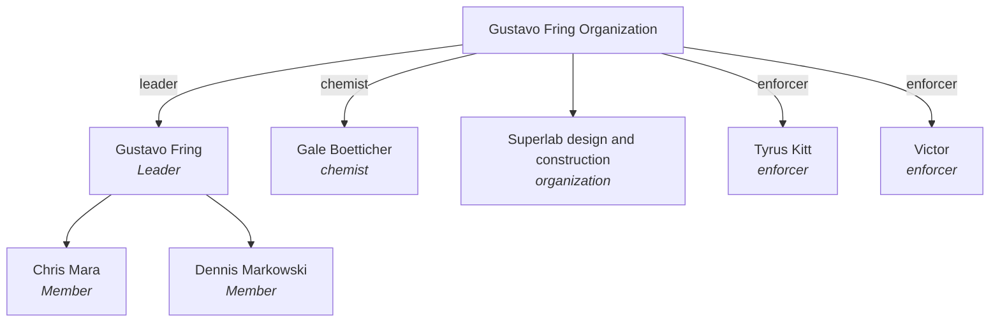

<div align="center">

# openhydra

[](https://ko-fi.com/meridiangray)

[](src/hydra/__init__.py)
[](#)
[](pyproject.toml)
[](LICENSE)
[](https://followthemoney.tech)
[](https://github.com/meridiangray/openhydra-mcp)

</div>

Hydra translates evidence into data points with a simple framework. It gives investigators simple interfaces for the hard parts of labelled data: sources that conflict, provenance for every value, and hierarchies that render easily to a directed graph.

OpenHydra expects [FollowTheMoney](https://github.com/alephdata/followthemoney) style data with one important difference: OpenHydra uses field values and not entity IDs as field values. 

## What it looks like

Every example below is the Breaking Bad demo archive that ships with the tests.

Records become a tree, drawn once under one parent, with every other parent listed so nothing is hidden:

```text
$ hydra-ctl tree gus
Gustavo Fring (Person) — Leader
│ also  Juarez Cartel                      Membership           distributor
│ also  Los Pollos Hermanos                Directorship         president
│ also  Superlab design and construction   ProjectParticipant   sponsor
├── Chris Mara (Person) — Member
│     also  Gustavo Fring Organization   Membership   member
└── Dennis Markowski (Person) — Member
      also  Gustavo Fring Organization   Membership   member
```

Every value keeps the record, collection and source it came from:

```text
$ hydra-ctl claims gus
entity          type     id                      claims   collections
Gustavo Fring   Person   sess-96cfcd44:p-fring       15             2

    field         value                                                          record                    collection
    deathDate     2010                                                           sess-96cfcd44:p-fring     fring
                                                                                 fring-condensed:p-fring   fring-condensed
    sources       fring-condensed:doc-bb-casefile~p2                             fring-condensed:p-fring   fring-condensed
                  sess-96cfcd44:doc-bb-casefile~p2                               sess-96cfcd44:p-fring     fring
    …
```

When the sources disagree, Hydra asks instead of guessing, and opens on the fields in conflict:

```text
$ hydra-ctl review --only merges
[2/7] Merge · conflicting: date
  To'hajiilee shootout   and   Junkyard shootout — Tuco Salamanca killed

  operations:ev-tohajiilee   Event
     date        2010

  operations:ev-tuco   Event
     date      ≠ 2008

  all fields   fields in both   [conflicting fields]      Tab / Shift+Tab
Which is better?
  1  one entity
  2  two entities
  ? not sure   u undo   q quit
```

And any tree exports as a Mermaid chart, which renders right here on GitHub (`hydra-ctl tree gus --format mermaid --vertical`):



## How it works

An archive is a folder: your records in `collections/`, the rules that shape the hierarchy, and every decision you make in review. `hydra-ctl build` compiles it the same way every time, so two builds of the same archive give the same files, byte for byte.

When you're done, `hydra-ctl pack` turns the archive into one portable `.hydra` file, and `hydra-ctl export` writes it for other tools. Standard FollowTheMoney goes to Aleph and OpenSanctions tooling, and CSV or GraphML goes to Neo4j, Gephi and Cytoscape.

Hydra reads standard FollowTheMoney as it comes. Its own dialect writes links as names instead of ids, which is easier for people (and AI assistants) to write by hand.

## Install

Python 3.11 or later, from GitHub:

```sh
uv tool install git+https://github.com/meridiangray/openhydra      # or: pip install git+https://github.com/meridiangray/openhydra
```

## Quick start

```sh
hydra-ctl init case --name "My Case"     # a new archive
cp ~/exports/*.json case/collections/    # your FollowTheMoney records
cd case
hydra-ctl build                          # merge, place, find the open questions
hydra-ctl tree                           # the org chart
hydra-ctl review                         # answer the questions one by one
```

## With an AI assistant

[hydra-mcp](https://github.com/meridiangray/openhydra-mcp) is an MCP server that lets an assistant like Claude read a document, write its facts as records and save them to your archive, with the document kept as the source every entity cites. Anything uncertain is left for you in `hydra-ctl review`.

## Documentation

The full guide covers every command and flag, with the real output of each: [guide/docs](guide/docs/index.md).

## License

Copyright (c) 2026 Meridian Gray. Hydra's program code is free software under the [GNU Affero General Public License, version 3 only](LICENSE). If you run a modified version as a network service, the AGPL requires you to offer its users the source of your changes. The template that `hydra-ctl init` copies into every archive (the schema, rules and settings files) is MIT licensed, so an archive you create is yours to license as you like; your records and sources are not part of Hydra. The vendored FollowTheMoney schema keeps its own MIT license (the FollowTheMoney authors, OCCRP / Alephdata). See [NOTICE.md](NOTICE.md).

## Contributing

See [CONTRIBUTING.md](CONTRIBUTING.md). Before a pull request can merge, you agree once to the [Contributor Agreement](CLA.md).
